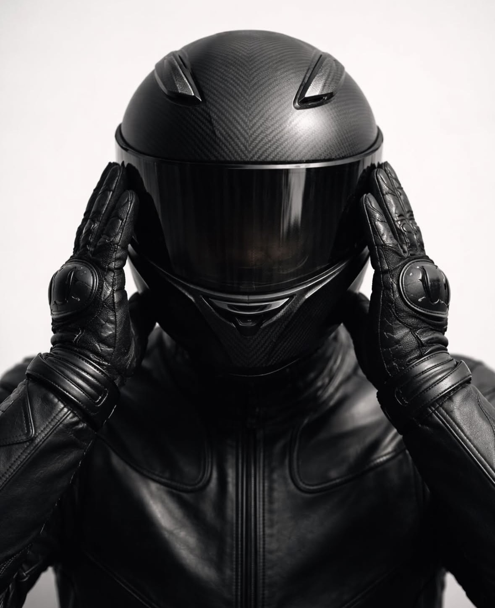

  
  

    <h1>O Piloto Interior</h1>
    
Motociclismo e mente forte: 15.000 km entre a Bandeirantes e a Marginal Pinheiros, e o que aconteceu dentro do capacete.

    
Tiago

  

Seja bem-vindo. Este é um livro que está sendo escrito agora, capítulo por capítulo.

Durante um ano, rodei 15.000 km de moto entre Limeira e São Paulo, sempre no horário de pico. A estrada é o cenário, mas a história de verdade é outra: como o medo deu lugar a uma mente forte, construída com meditação, observação e resiliência, e como isso virou uma forma de pilotar com segurança.

**O Piloto Interior** é o lado de cada um de nós que quer fazer a diferença. A voz calma que aparece quando o medo grita.

## Comece por aqui

<a class="botao" href="capitulos/01-a-janela-do-onibus.html">Ler o Capítulo 1: A janela do ônibus</a>

É a abertura do livro e o melhor lugar para começar. Dois meses de ônibus, uma Triumph Tiger parada na garagem e uma pergunta olhando pela janela da Marginal: *se eles conseguem, por que eu tenho tanto medo?*

## Capítulos já escritos

<ul class="escritos">

  <li><a href="{{ c.arquivo | replace: '.md', '.html' }}">{{ c.numero }} {{ c.titulo }}</a> Parte {{ parte.parte }}</li>

</ul>

Os capítulos não estão sendo escritos em ordem. O mapa completo, com as quatro partes e os capítulos que ainda virão, está no [sumário](sumario.html).

## Um livro em construção

Tudo aqui é rascunho. Você vai encontrar trechos entre colchetes, que são lacunas ainda por preencher, e notas de edição no começo de cada capítulo. A versão final será publicada em PDF.

Este livro é para motociclistas, iniciantes ou experientes, que sentem medo no trânsito. E também para quem nunca pilotou, mas quer aprender a lidar com o medo em qualquer área da vida.
